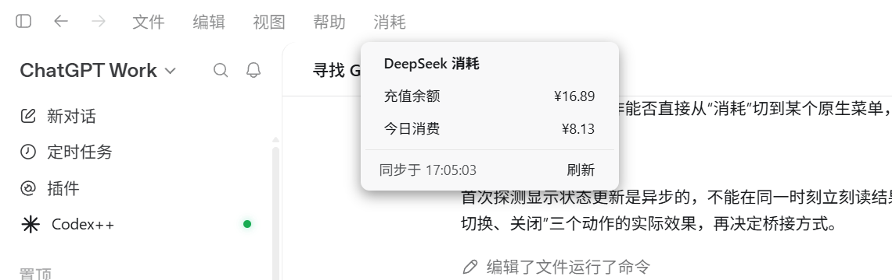

# DeepSeek 消耗 · Codex 桌面端插件

给 Codex 桌面端顶部菜单栏加一个「消耗」按钮，随时查看 DeepSeek 的**充值余额**与**今日消费**。

```
文件 | 编辑 | 视图 | 帮助 | 消耗
```



点开就是一张小卡片：只有两行数字、同步时间和刷新按钮；不点刷新时默认每 360 秒自动同步一次。

> 卡片显示的「账户余额」= 充值余额 + 赠送余额，与 DeepSeek 官网的账户余额口径一致。

---

## 特点

- **不依赖 Codex++**：Codex++ 卸载后依然可用。插件自己通过 CDP 把卡片注入 Codex 窗口。
- **不注册任何开机自启**：数据助手由 Codex 通过 MCP 拉起，Codex 退出即回收。
- **不需要单独配置密钥**：余额用 `~/.codex/auth.json` 或 `~/.codex/config.toml` 里现成的 key。
- **今日消费只显示精确值**：登录态从 Codex 内置浏览器的本地存储读取，取不到就显示 `—`，不做任何估算。
- **装在用户目录**，不碰 Codex 安装目录，卸载能还原。

## 工作原理

```
Codex 启动
   └─ 按 ~/.codex/config.toml 的 [mcp_servers.deepseek_usage] 拉起 mcp-server.ps1
          ├─ 拉起数据助手 deepseek-usage-helper.ps1
          │     ├─ 取余额（DeepSeek 官方接口）
          │     ├─ 取今日消费（platform.deepseek.com 网页版接口）
          │     └─ 通过本机调试端口 9229 注入卡片并推送数据
          └─ 若发现 Codex 没带调试端口，排队一次自动修复（见下）
```

页面脚本只负责画界面，一个字节的数据都不由它去取；取数全部在 PowerShell 助手里完成。

### 数据来源

| 指标 | 来源 | 说明 |
|---|---|---|
| 账户余额 | `https://api.deepseek.com/user/balance` | 官方接口，`topped_up_balance` + `granted_balance` |
| 今日消费 | `https://platform.deepseek.com/api/v0/usage/by_api_key/cost` | 网页版 `platform.deepseek.com/usage` 选「今日」看到的数字 |

今日消费的登录态（`userToken`）只从 **Codex 内置浏览器**的 Local Storage 读取：
在 Codex 里打开 `platform.deepseek.com` 扫码登录一次即可长期有效，插件不读取你日常 Chrome 的登录态。

凭证解析顺序：`config.json` 的 `apiKey` → `~/.codex/auth.json` 的 `OPENAI_API_KEY` → `~/.codex/config.toml` 的 `experimental_bearer_token`。
最后一项是为了兼容 cc-switch 这类代理工具（它们把 token 写进 `config.toml`，不再生成 `auth.json`）。

余额与今日消费相互独立：任一项失败只影响自己那一行。

## 环境要求

- Windows 10 / 11
- Codex 桌面端（商店版 / MSIX 均可）
- 在 Codex 内置浏览器里登录过 DeepSeek 网页版（只为「今日消费」这一项）

## 安装

```powershell
powershell -NoProfile -ExecutionPolicy Bypass -File .\install.ps1
```

安装脚本会：

1. 把插件复制到 `%LOCALAPPDATA%\Programs\DeepSeekUsage`；
2. 在 `~/.codex/config.toml` 注册 MCP 服务器；
3. 在桌面放置「启动 Codex（带消耗按钮）.cmd」。

## 关于调试端口（重要）

菜单栏按钮依赖 Codex 的 CDP 调试端口（默认 `9229`）做注入。商店版 Codex 有单实例锁，**已经开着的实例不会接受端口参数**，所以：

- **自动方式（默认）**：Codex 启动后，插件若发现没有端口，会自动排队一次重启（默认 45 秒后执行），把 Codex 重启并带上端口。每个会话只尝试一次，两次之间至少间隔 20 分钟，连续失败 2 次自动停用，不会陷入重启循环。
- **手动方式**：双击桌面「启动 Codex（带消耗按钮）.cmd」，它会退出并重启 Codex（带端口）。

如果直接用任务栏/开始菜单启动 Codex 且自动修复被跳过，菜单栏不会出现「消耗」；此时用桌面入口重启一次即可。

## 配置

`%LOCALAPPDATA%\Programs\DeepSeekUsage\config.json`

| 字段 | 默认 | 说明 |
|---|---|---|
| `debugPort` | `9229` | Codex 的 CDP 调试端口 |
| `refreshSeconds` | `360` | 助手自动刷新间隔（秒） |
| `pollSeconds` | `2` | 助手轮询页面间隔（秒） |
| `apiKey` | 空 | 留空则按上面的顺序自动解析 |
| `uiScript` | 自动 | 卡片脚本路径，一般不用改 |
| `autoRestart` | `true` | 是否在缺少端口时自动重启 Codex |
| `autoRestartDelaySeconds` | `45` | 自动重启前的等待秒数 |
| `autoRestartCooldownMinutes` | `20` | 两次自动重启之间的最小间隔 |

## 排查

日志目录：`%LOCALAPPDATA%\Programs\DeepSeekUsage\`

| 文件 | 内容 |
|---|---|
| `launcher.log` | MCP 启动器：拉起助手、自动修复排队 |
| `auto-restart.log` | 自动修复：重启 Codex 的全过程 |
| `launch.log` | 启动器：端口是否就绪、新进程命令行 |
| `helper.log` | 数据助手：取数与注入结果 |

常见情况：

| 现象 | 处理 |
|---|---|
| 菜单栏没有「消耗」 | 端口没开。看 `launcher.log` 与 `auto-restart.log`；或用桌面入口手动重启 Codex |
| 「今日消费」显示 `—` | Codex 内置浏览器里没有 DeepSeek 登录态，打开 `platform.deepseek.com` 重新登录 |
| 「获取失败」 | 看 `helper.log`；通常是凭证找不到，可在 `config.json` 里直接填 `apiKey` |
| 切换供应商后插件消失 | cc-switch 会整份覆盖 `config.toml`，重跑一次 `install.ps1` |

## 卸载

```powershell
powershell -NoProfile -ExecutionPolicy Bypass -File .\uninstall.ps1
```

会停掉相关进程、移除桌面入口、从 `config.toml` 摘掉 MCP 注册并删除安装目录。重启 Codex 后按钮消失。

## 目录结构

```
deepseek-usage-panel.js        注入 Codex 页面的卡片脚本（菜单栏按钮 + 卡片）
install.ps1 / uninstall.ps1    安装 / 卸载
launch-codex.ps1               以调试端口启动 Codex 的启动器
launch-codex.cmd               启动器的双击入口
helper/
  deepseek-usage-helper.ps1    取数并通过 CDP 注入 / 推送
  mcp-server.ps1               MCP 启动器：Codex 拉起它，它拉起助手并负责自动修复
  auto-restart.ps1             自动修复工作进程：重启 Codex 并带上调试端口
HANDOFF.md                     维护与交接文档（含踩坑记录）
docs/screenshot.png            效果截图
```

## 许可

[MIT](LICENSE)

## 免责声明

非官方项目，与 OpenAI、DeepSeek 均无关联。「今日消费」依赖 DeepSeek 网页版内部接口，可能因对方改版而失效；
请自行判断使用风险。本项目只读取你自己的账户数据，不发送到任何第三方。
